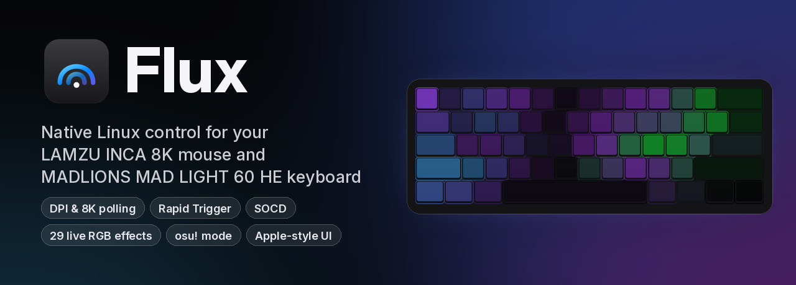
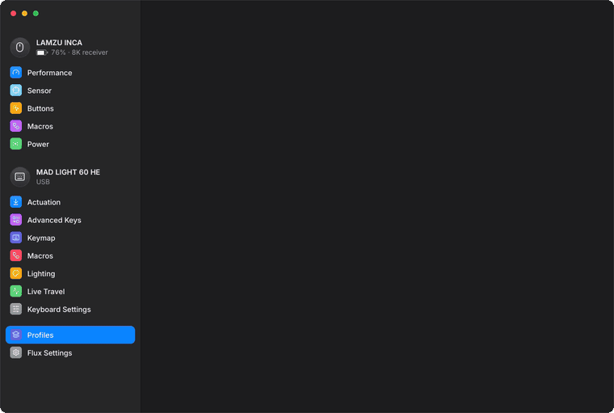
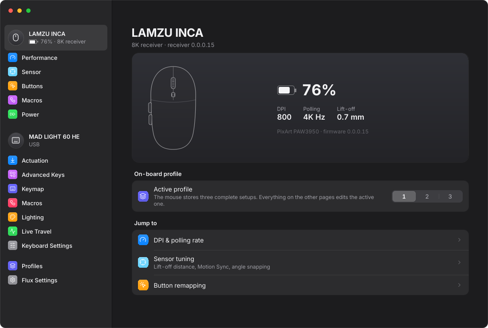
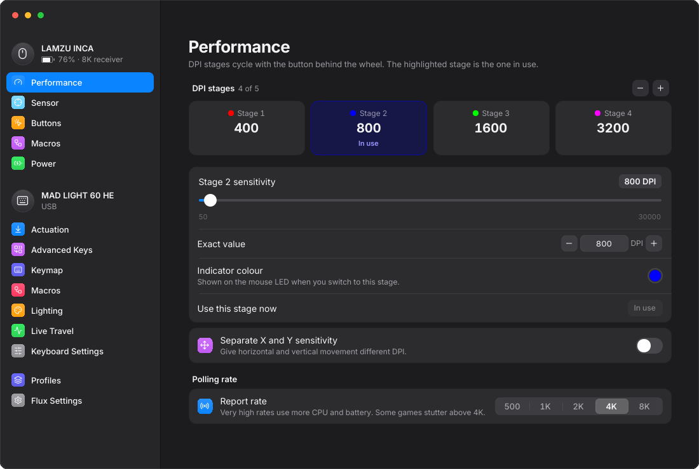
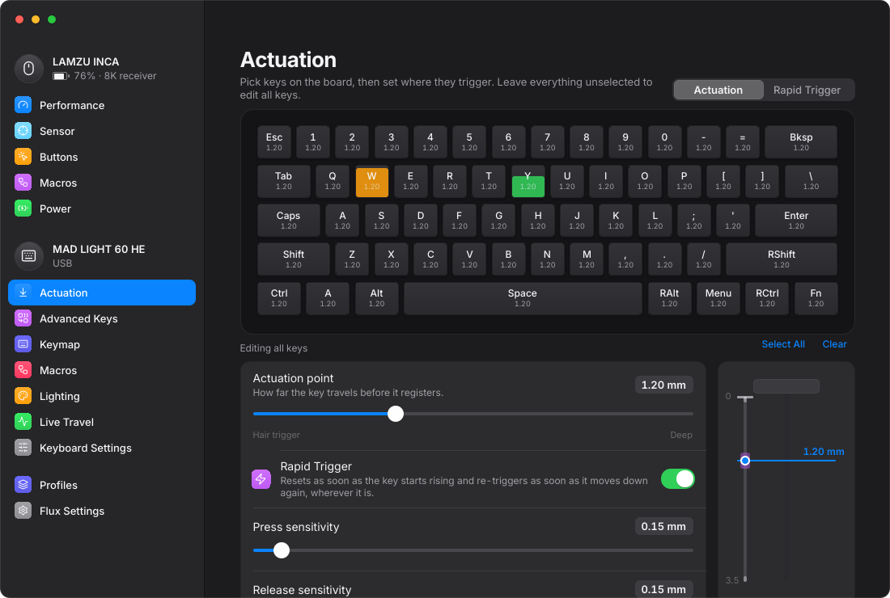
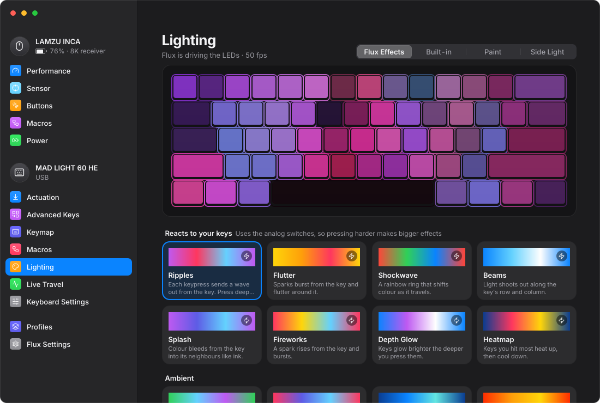
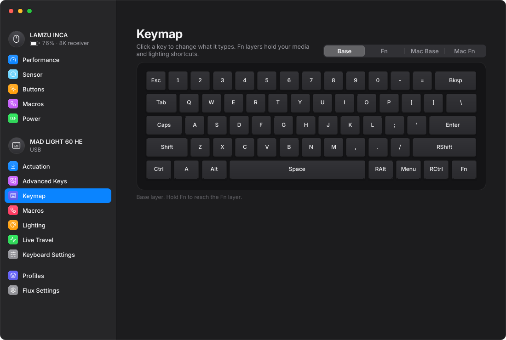
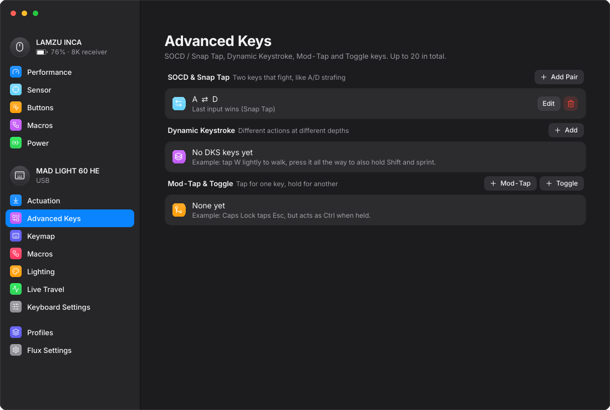
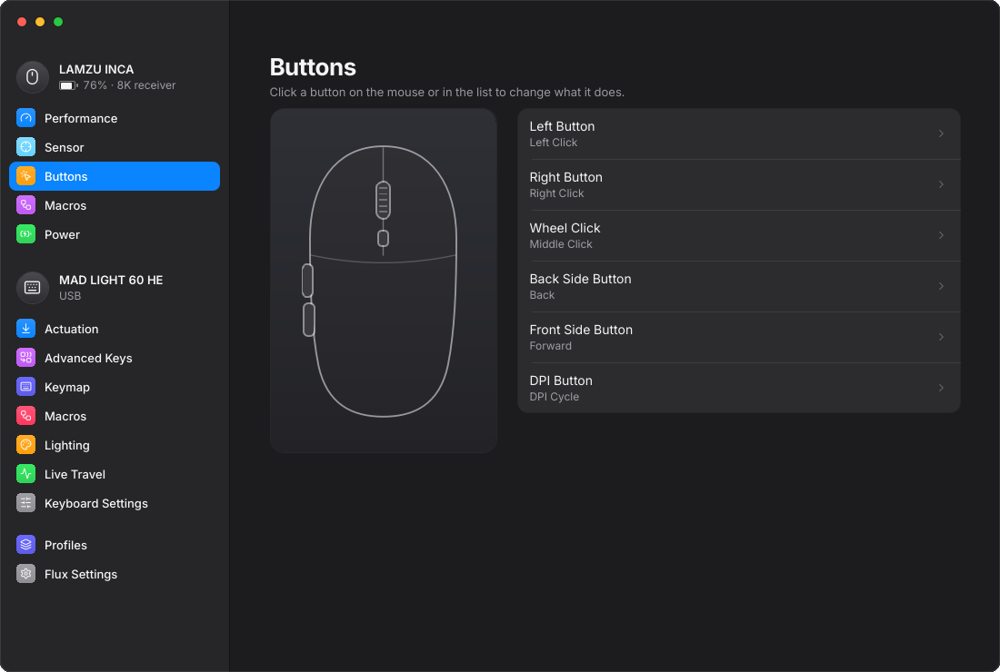
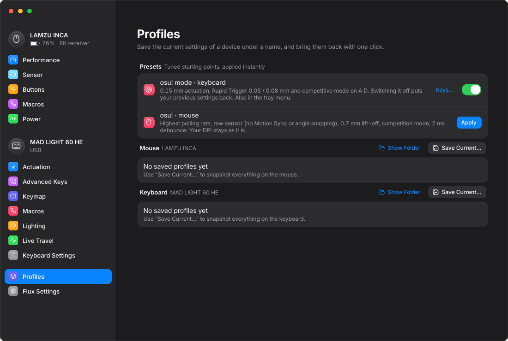

<p align="center">
  
</p>

<p align="center">
  <a href="https://github.com/SwiftAkira/Drivers/stargazers"></a>
  <a href="LICENSE"></a>
  
  
  
  <a href="https://github.com/SwiftAkira/Drivers/commits/main"></a>
</p>

<p align="center">
  <b>A native Linux app for the LAMZU INCA 8K mouse and the MADLIONS MAD LIGHT 60 HE Hall-effect keyboard.</b><br>
  Every setting from the vendor apps, plus live RGB effects they can't do. No Windows, no browser driver.
</p>

<p align="center">
  <a href="#-install">Install</a> ·
  <a href="#-first-run">First run</a> ·
  <a href="#-features">Features</a> ·
  <a href="#-flux-effects">Lighting effects</a> ·
  <a href="#-osu-setup">osu! setup</a> ·
  <a href="#-troubleshooting">Troubleshooting</a> ·
  <a href="#-faq">FAQ</a>
</p>

<p align="center">
  
</p>

---

##  Why Flux?

LAMZU and MADLIONS only ship configuration tools for Windows and Chrome. On Linux that leaves you stuck with whatever was last saved on the device. Flux talks to both devices directly over USB HID, using the same commands as the vendors' own apps (reverse-engineered from them, see [How it works](#-how-it-works)). It wraps them in a clean, dark, Apple-style interface with springy animations.

- **Mouse:** DPI stages, 8K polling, lift-off distance, Motion Sync, button remaps, macros, battery in the tray.
- **Keyboard:** per-key actuation, Rapid Trigger, SOCD / Snap Tap, Dynamic Keystroke, keymap, macros, lighting.
- **Flux Effects:** 29 live, per-key lighting effects. Some react to how *deep* you press a key, some react to the music you're playing.
- **osu! mode:** one switch for hair-trigger tapping keys, and the same switch puts your old settings back.

##  Supported hardware

| Device | Connection | USB ID | Status |
|---|---|---|---|
| **LAMZU INCA 8K** | 8K receiver | `37b0:0010` | Tested |
| **LAMZU INCA 8K** | USB cable | `37b0:0009` | Untested (same protocol) |
| **LAMZU INCA 8K** | 1K receiver | `37b0:000f` | Untested (same protocol) |
| **MADLIONS MAD LIGHT 60 HE** | USB | `373b:10f6` | Tested |

Other LAMZU "Aurora" mice and FGG/MADLIONS "DuckBread" keyboards probably use the same protocols, but they're not enabled yet. See [Contributing](#-contributing).

---

##  Install

### Arch Linux / CachyOS / EndeavourOS / Manjaro (recommended)

**1. Install the build tools** (skip any you already have):

```bash
sudo pacman -S --needed git base-devel cmake ninja qt6-base qt6-declarative qt6-svg qt6-shadertools hidapi kwindowsystem kstatusnotifieritem
```

**2. Download Flux:**

```bash
git clone https://github.com/SwiftAkira/Drivers.git flux && cd flux
```

**3. Build and install it as a package** (asks for your password once):

```bash
cd packaging/arch && makepkg -si
```

This installs:

| What | Where |
|---|---|
| The app | `/usr/bin/flux` |
| The command-line tool | `/usr/bin/fluxctl` |
| A launcher entry | your app menu |
| A **udev rule** that lets your user account talk to the devices without root | `/usr/lib/udev/rules.d/70-flux.rules` |

**4. Unplug and replug** the mouse receiver and keyboard, so the new permission rule applies to them.

**5. Open Flux** from your app launcher, or run `flux`.

> **Updating later:** run `git pull` in the `flux` folder, then `cd packaging/arch && makepkg -si` again.

### Other distributions

You'll need a C++20 compiler, CMake ≥ 3.24, Ninja, **Qt ≥ 6.7** (Base, Declarative, Svg, ShaderTools), **KF6** WindowSystem and StatusNotifierItem, hidapi, and libudev.

```bash
git clone https://github.com/SwiftAkira/Drivers.git flux && cd flux
cmake -S . -B build -G Ninja -DCMAKE_BUILD_TYPE=Release -DCMAKE_INSTALL_PREFIX=/usr
cmake --build build
sudo cmake --install build
sudo udevadm control --reload && sudo udevadm trigger --subsystem-match=hidraw
```

### Just want to look?

Run Flux with simulated devices. Nothing is sent to any hardware:

```bash
flux --demo
```

---

##  First run

1. **Open Flux.** Your mouse and keyboard appear in the sidebar within a second or two.
2. **See "Permission needed"?** The udev rule isn't active yet. Replug the devices, or click **Copy** on that screen and run the command it shows.
3. **Mouse asleep?** Wireless mice sleep when idle. Move it, and its settings load automatically.
4. **Pick a page in the sidebar.** Every change is written to the device instantly, and a small pill at the bottom confirms it.
5. **Keep it running.** Turn on **Flux Settings → Open at login**. Flux then starts in the tray, shows your mouse battery, warns you when it's low, and keeps your live lighting effects running.
6. **Save your setup.** Under **Profiles → Save Current…** you can snapshot everything and bring it back with one click.

---

##  Features

<details open>
<summary> <b>LAMZU INCA 8K</b></summary>

- **DPI:**
  - 1–5 stages from 50 to 30,000 DPI, with optional separate X/Y values.
  - A colour per stage for the DPI LED, and you choose which stage is active.
- **Polling rate:** 125 Hz to 8 kHz. The options match the connection: up to 8K on the 8K receiver, up to 1K by cable or on the 1K receiver.
- **Sensor:**
  - Lift-off distance (0.7 / 1 / 2 mm), Motion Sync, angle snapping, angle tune (±30°), ripple control.
  - Competition mode, plus 20K FPS mode on firmware ≥ 0.0.0.16.
- **Clicks:** debounce time from 0 to 15 ms.
- **Buttons:** remap all six. Click a button on the mouse drawing to choose:
  - Mouse clicks.
  - Keyboard shortcuts: press the shortcut to bind it.
  - Media keys.
  - DPI cycle / up / down / sniper lock.
  - Rapid fire.
  - Macros.
  - Polling-rate or LOD cycling.
  - Disabled.
- **Macros:** a recorder that captures keys, clicks, scrolls and pauses. Up to 30 macros, stored on the mouse.
- **Profiles:** switch between the 3 profiles stored on the mouse.
- **Power:** battery level and charging status, sleep timer, low-battery notifications, and a tray icon that fills up with charge.
- **Factory reset** of the mouse and receiver.

</details>

<details open>
<summary> <b>MADLIONS MAD LIGHT 60 HE</b></summary>

- **Actuation:**
  - Per key or whole board, 0.10–3.50 mm.
  - Select keys by clicking, shift-clicking or dragging a box around them.
- **Rapid Trigger:** separate press and release sensitivity, down to 0.01 mm in competitive mode.
- **Dead zones:** top and bottom.
- **Live Travel:** see every key's exact depth in real time, and run switch calibration.
- **Advanced keys:**
  - SOCD / Snap Tap (last input, either key wins, neutral) and Rappy Snappy.
  - Dynamic Keystroke (different actions at different depths).
  - Mod-Tap and Toggle keys.
- **Keymap:**
  - All 4 layers (Win, Win Fn, Mac, Mac Fn).
  - Press a key to bind it.
  - Fn, Fn Lock, Win ⇄ Mac, WASD ⇄ arrows and NKRO toggles.
- **Macros:** VIA-style macros you can place on any key.
- **Lighting:** the keyboard's 21 built-in effects, per-key painting, the side light, and [Flux Effects](#-flux-effects).
- **Settings:** competitive mode, bottom-out trigger, Win-key lock, NKRO, Mac mode, keymap reset, factory reset.

</details>

<details open>
<summary> <b>App</b></summary>

- **Looks:**
  - Dark, Apple-style design with Inter type and spring animations.
  - A real KWin blur behind the sidebar and a native window shadow.
  - "Reduce motion" setting.
- **Profiles:** save and restore full device snapshots as JSON, plus one-click **osu!** presets.
- **Tray:** a tray app with mouse battery and an osu! mode toggle. Autostarts at login, and only one copy runs at a time.
- **Safety:**
  - Changes appear instantly in the app, are written in the background, and roll back if the device rejects them.
  - Flux never sends firmware or bootloader commands.

</details>

---

##  Flux Effects

The keyboard's built-in effects are fine, but limited. **Flux Effects are rendered by Flux and streamed to the keyboard live, one key at a time.** Some react to the analog depth of each keypress (only a Hall-effect board can do this), some to the music playing on your PC.

<p align="center">
  
</p>

|  Reacts to your keys |  Reacts to sound |  Ambient |
|---|---|---|
| **Ripples:** a wave out of every press; press deeper for a bigger wave | **Sound Wave:** the waveform of what's playing, drawn across the keys | **Aurora:** drifting curtains of light |
| **Flutter:** sparks burst out and flutter around the key | **Spectrum:** 14 frequency bars with falling peaks | **Plasma:** liquid colour fields |
| **Shockwave:** a ring that shifts through the rainbow | **Bass Drop:** every kick drum sends a shockwave from the spacebar | **Ocean:** rolling waves with foam |
| **Beams:** light shoots along the key's row and column | **Audio Aura:** a colour field that moves and glows with the music | **Ember:** flames rising from the bottom |
| **Splash:** colour bleeds into the neighbours like ink | | **Neon Rain:** falling streaks |
| **Fireworks:** a spark rises from the key and bursts | | **Starlight:** a twinkling night sky |
| **Magnetic Field:** presses become magnetic poles with flowing field lines | | **Spectrum Spin:** a rotating rainbow |
| **Water:** real wave physics, where ripples interfere and bounce | | **Gradient Drift:** your palette, slowly turning |
| **Lightning:** bolts from each press; hold two keys for a Tesla arc | | **Breathe:** a calm breathing glow |
| **Ink:** colour swirls like smoke in water | | |
| **Constellation:** your presses become stars joined by lines | | |
| **Life:** Conway's Game of Life, seeded by your typing | | |
| **Tempo:** learns your tapping BPM and pulses on the beat | | |
| **Echo:** each press ping-pongs across the board | | |
| **Depth Glow:** keys glow brighter the deeper you press | | |
| **Heatmap:** the keys you hit most heat up | | |

**Every effect** has a 3-colour palette, speed and brightness controls. **Bake** saves the current frame to the keyboard as a static design, so it stays even when Flux isn't running.

> **Good to know:**
> - Live effects need Flux running, either open or in the tray. Turn on **Open at login** and they'll start with your PC.
> - Audio effects use `parec` (part of `libpulse`) to listen to your default output; they work with PipeWire.

---

##  osu! setup

Flux has a one-click osu! mode, set up for **A + D** by default:

1. Open **Profiles**. Under **Presets → osu! mode · keyboard**, turn the switch on. The same switch is in the tray menu.
2. Your tap keys get **0.15 mm actuation** and **Rapid Trigger at 0.05 mm press / 0.08 mm release**, and **competitive mode** is turned on. The slightly larger release keeps a relaxed finger from breaking sliders.
3. Using different keys? Click **Keys…** and pick them. Quick sets: **Z X**, **mania 4K** (D F J K) and **7K** (S D F Space J K L).
4. Switch osu! mode **off**, and every key goes back to exactly how it was before.
5. For the mouse, **osu! · mouse → Apply** sets:
   - the highest polling rate
   - raw sensor output (no Motion Sync, no angle snapping)
   - 0.7 mm lift-off distance
   - competition mode
   - 2 ms debounce

   Your DPI is left alone.
6. Bonus: try the **Tempo** lighting effect. It learns your tapping BPM and pulses the board on the beat.

---

##  Screenshots

| | |
|---|---|
|  |  |
| **Mouse overview:** battery, DPI, polling, profiles | **Performance:** DPI stages, LED colours, polling rate |
|  |  |
| **Actuation:** per-key travel, Rapid Trigger, live depth | **Lighting:** Flux Effects with a live preview |
|  |  |
| **Keymap:** press-to-bind, Fn and layer keys | **Advanced keys:** SOCD / Snap Tap, DKS, Mod-Tap |
|  |  |
| **Buttons:** click the mouse to remap | **Profiles:** snapshots and the osu! switch |

---

##  Command line

`fluxctl` uses the same protocol code as the app. It's handy for scripts, or for checking that a device responds:

```bash
fluxctl list                     # supported devices and their HID nodes
fluxctl mouse info               # firmware, polling, LOD, battery, toggles
fluxctl mouse dpi                # DPI stages (* = active)
fluxctl mouse set-dpi 2 1600     # set stage 2 to 1600 DPI
fluxctl mouse polling 4000       # polling rate in Hz
fluxctl kb info                  # firmware, features, lighting, macros
fluxctl kb actuation             # actuation point of every key (mm)
fluxctl kb travel                # live key depth snapshot (mm)
fluxctl kb keymap                # raw keycodes for all 4 layers
```

---

##  Troubleshooting

<details>
<summary><b>"Permission needed": Flux sees the device but can't open it</b></summary>

Flux's udev rule isn't active for that device yet. Replug the receiver or keyboard. If you built Flux without the package, install the rule:

```bash
sudo install -Dm644 packaging/70-flux.rules /etc/udev/rules.d/70-flux.rules
sudo udevadm control --reload && sudo udevadm trigger --subsystem-match=hidraw
```
</details>

<details>
<summary><b>The mouse shows "asleep"</b></summary>

Wireless mice power down when idle. Move or click it; Flux notices within a few seconds and loads its settings.
</details>

<details>
<summary><b>My lighting effect stops when I close Flux</b></summary>

Live effects are drawn by Flux. Closing the window keeps Flux running in the tray, but **Quit** stops the effect. Turn on **Flux Settings → Open at login**, or use **Bake** to save a frame to the keyboard permanently.
</details>

<details>
<summary><b>Audio effects don't react</b></summary>

They need `parec`, which comes with `libpulse` (`sudo pacman -S libpulse`), and audio playing on your **default output** device. If you switch outputs (for example to Bluetooth headphones), pick the effect again so it listens to the new one.
</details>

<details>
<summary><b>Settings change by themselves or keys show wrong values</b></summary>

Close the vendor web driver (hub.fgg.com.cn) or any other configuration tool. Only one program should talk to a device at a time.
</details>

<details>
<summary><b>No blur behind the sidebar / no tray icon (non-KDE desktops)</b></summary>

Blur and the native shadow are KDE Plasma (KWin) features; elsewhere the sidebar is simply opaque. On GNOME, install the *AppIndicator and KStatusNotifierItem Support* extension to see the tray icon.
</details>

---

##  FAQ

<details>
<summary><b>Is it safe? Can it brick my device?</b></summary>

Flux only sends the same settings commands the official apps send. It **never** sends firmware-update or bootloader commands, and both devices have a factory reset in Flux if you want a clean slate. Your settings are stored on the devices themselves, so they work on any computer, even without Flux.
</details>

<details>
<summary><b>Does it work on Windows or macOS?</b></summary>

No. Flux is built for Linux, and the vendors already have official apps for Windows.
</details>

<details>
<summary><b>Can the custom effects run on the keyboard without Flux?</b></summary>

Animated ones can't: the keyboard's firmware can only store its own 21 effects plus one static per-key design. Flux can **Bake** any frame of a Flux Effect into that static design. A custom-firmware investigation is on the roadmap.
</details>

<details>
<summary><b>Will my other LAMZU mouse or MADLIONS keyboard work?</b></summary>

Possibly. LAMZU's "Aurora" mice (Maya X, Thorn V2, Paro Aurora, Tachi…) and FGG's "DuckBread" keyboards share these protocols. They're not enabled yet, so they can't be configured by mistake. If you have one, please open an issue with the output of `fluxctl list`.
</details>

<details>
<summary><b>Wayland or X11?</b></summary>

Both. Flux is built and tested on KDE Plasma 6 with Wayland, and works on X11 too.
</details>

---

##  How it works

Flux is C++20 with Qt 6 Quick (QML). Each device gets its own I/O thread that talks raw HID through `hidapi`, and the UI never waits on hardware.

The protocols were reverse-engineered by static analysis of the vendors' own software, and are documented in full:

- [`docs/protocol-lamzu-inca.md`](docs/protocol-lamzu-inca.md) covers the LAMZU "Aurora" protocol: 64-byte feature reports, plus push events for battery, DPI and sleep.
- [`docs/protocol-mad-light-60-he.md`](docs/protocol-mad-light-60-he.md) covers QMK VIA raw HID plus the vendor extensions (actuation, Rapid Trigger, SOCD, DKS, lighting, calibration).

Fun fact: this keyboard's firmware applies a multi-key colour packet that runs past the end of a row onto the *next* row's first keys. So Flux streams lighting one key at a time, and only for keys that changed.

```
src/core/          HID wrapper, I/O worker thread, device manager (udev hot-plug)
src/devices/lamzu/ LAMZU protocol + mouse model
src/devices/mad/   MADLIONS protocol + keyboard model + Flux Effects engine
src/app/           tray, settings, profiles, window chrome, audio capture
qml/               the interface (controls/, pages/)
```

---

##  Roadmap

- [x] Full LAMZU INCA 8K support
- [x] Full MAD LIGHT 60 HE support, including Rapid Trigger and SOCD
- [x] 29 live lighting effects (key-reactive and audio-reactive)
- [x] osu! mode
- [ ] AUR package
- [ ] Global hotkey for osu! mode
- [ ] More LAMZU Aurora mice and FGG DuckBread keyboards
- [ ] Custom effect editor
- [ ] Custom keyboard firmware investigation

##  Contributing

Issues and pull requests are welcome, especially from people with other LAMZU or MADLIONS/FGG devices.

- `flux --demo` runs the whole app without hardware.
- `flux --demo --screenshot <dir>` renders every page to PNGs.
- `fluxctl` lets you poke at a real device.

##  Star history

If Flux saved you from booting Windows, a star helps other Linux users find it.

<a href="https://star-history.com/#SwiftAkira/Drivers&Date">
  
</a>

##  License

[MIT](LICENSE) © Orion Lamme.

Bundled assets:
- [Inter](https://rsms.me/inter/) font, SIL OFL 1.1.
- [Lucide](https://lucide.dev) icons, ISC licence.

Flux is an independent project, **not affiliated with LAMZU, MADLIONS or FIERCE GAMING GEAR**. Product names are trademarks of their owners.
